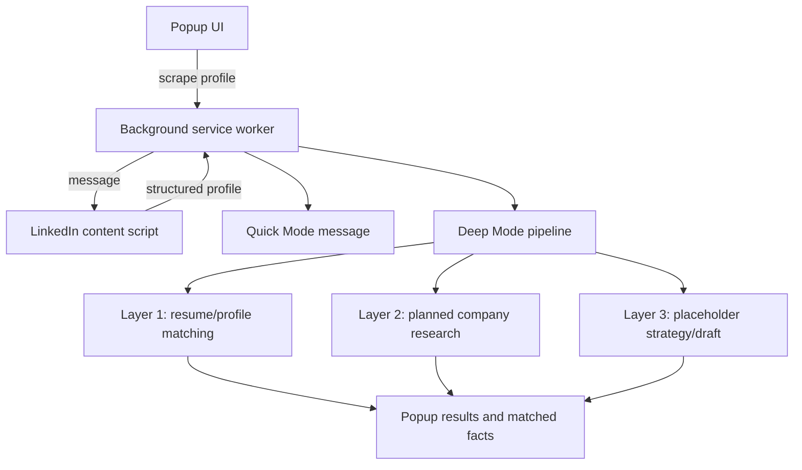

# Architecture and data flow

## Entry points

| File | Responsibility |
| --- | --- |
| `manifest.json` | Declares Chrome permissions, the service worker, popup, content script, and icons. |
| `src/background.js` | Routes popup messages, accesses extension storage, calls providers, and runs Deep Mode. |
| `src/content_script.js` | Reads rendered LinkedIn profile details and returns structured profile data. |
| `src/popup/` | Presents Quick Mode, Deep Mode, Settings, resume review, and results. |
| `src/layers/` | Builds the resume memory card and coordinates Deep Mode layers. |
| `src/utils/` | Shared storage, resume, fact, embedding, matching, prompt, and API helpers. |
| `tests/` | Unit tests and sample profile fixtures. |
| `scripts/` | Local development reports, including matcher score examples. |

## Request flow

## Resume card flow

1. The Settings popup reads PDF text or runs OCR locally through `src/utils/pdf.js`.
2. `src/utils/resume.js` extracts sections and removes detected contact details. The user reviews the sanitized sections before sending them.
3. The background worker passes the reviewed sections to Groq. `src/layers/memory.js` validates the response, ignores model-provided identity fields, and builds a structured card.
4. The user reviews and saves the card. The card is kept in Chrome local storage; an older saved PDF is removed after the card is saved.

## Deep Mode Layer 1

`src/layers/pipeline.js` runs the memory, company, and approach layers in order. For Layer 1, `src/layers/memory.js` turns the saved card and scraped profile into short facts. Direct email, phone, and recognized street-address patterns are removed from profile facts before embedding.

`src/utils/embeddings.js` creates and caches keyword vectors locally; matching has no hosted embeddings provider, model setting, or separate API key. `src/utils/matcher.js` combines cosine similarity with exact school, employer, skill, and tool matches; applies generic-overlap penalties; deduplicates the result; and returns up to six pairs. The popup displays the matched facts and scores.

Resume and viewed-profile facts stay on-device during matching. They are not sent to an embeddings service.

## Extension storage

| Key | Contents |
| --- | --- |
| `userApiKey` | Groq API key for message generation and resume-card structuring. |
| `memoryCard` | The structured resume card and its facts. |
| `vecCache` | Cached local keyword vectors keyed by fact type and text hash. |
| `recentContacts` | Recent generated message records. |

Use **Clear all my data** in Settings to remove extension-local data.
